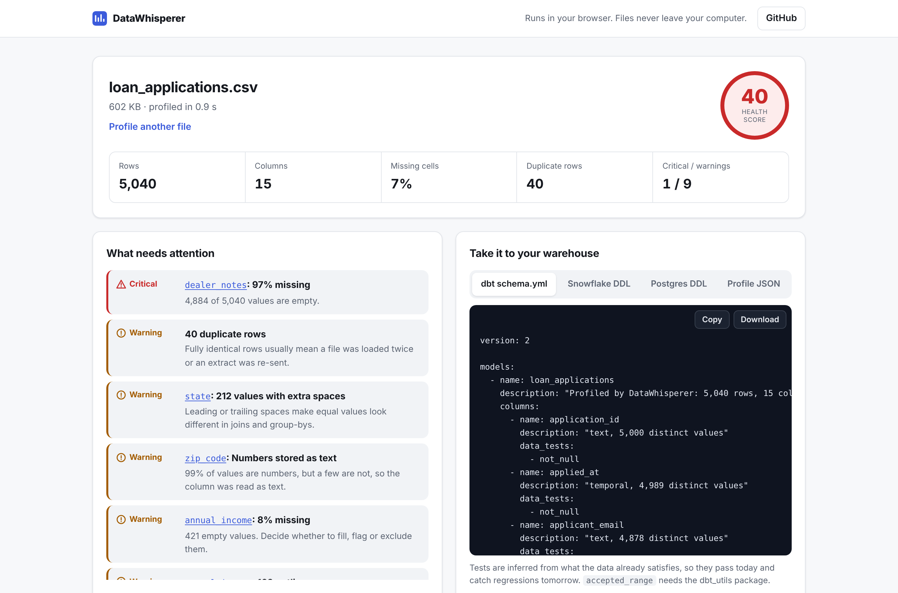
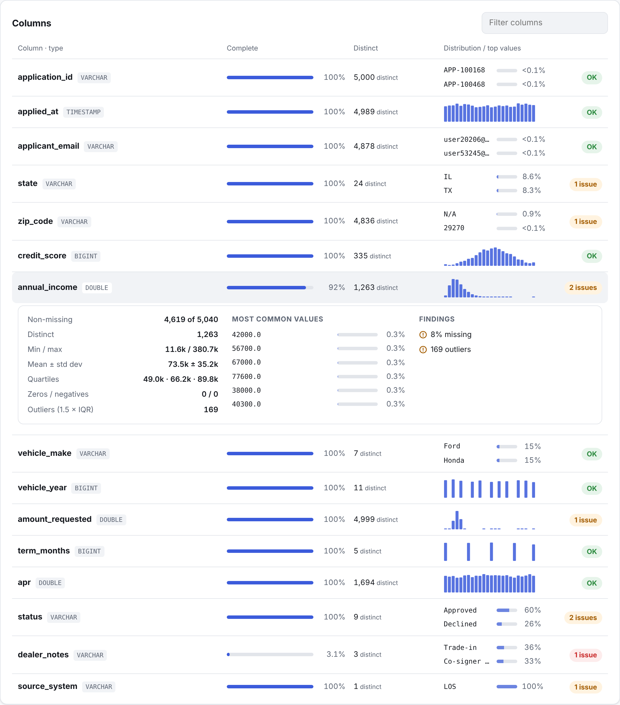

# DataWhisperer

**Profile any CSV in seconds, right in your browser.** Drop in a file and get column types, missing values, distributions, data quality findings and a health score, then export the result as dbt tests or warehouse DDL.

**[Live demo → kolli-jahnavi-07.github.io/datawhisperer](https://kolli-jahnavi-07.github.io/datawhisperer/)**

[](https://github.com/Kolli-Jahnavi-07/datawhisperer/actions/workflows/ci.yml)




## Why I built it

The first hour with a new source file usually looks the same: open it, run `count(*)`, check nulls column by column, look for duplicates, find out that `status` has both `Approved` and `approved `, and then hand-write the `not_null` and `unique` tests for the staging model. DataWhisperer does that first hour in about one second, and hands back the tests and DDL so the findings turn into guardrails instead of a note in a ticket.

It runs entirely client-side. The file is read by DuckDB compiled to WebAssembly inside the browser tab, so nothing is uploaded and it's safe to use on data you couldn't paste into a SaaS tool.

## What it checks

Every statistic is a SQL query over the **whole file** (no sampling), so the numbers match what the warehouse will say after loading.

| Area | What you get |
|---|---|
| Schema | Inferred DuckDB type per column, using every row (`sample_size = -1`) so a late `N/A` can't silently turn a column into text |
| Completeness | Missing values per column and overall |
| Distributions | Min, max, mean, std dev, quartiles, 24-bin histogram for numeric and date columns; top values for text |
| Keys | Candidate primary keys, near-unique columns that hint at duplicate keys, files with no single-column key |
| Quality rules | Duplicate rows, outliers (1.5 × IQR), rare negatives, untrimmed strings, numbers stored as text, the same category spelled differently, constant columns, empty columns |
| Sensitive data | Columns that look like emails, phone numbers or IP addresses, flagged as PII |

Findings are graded **critical / warning / note** and roll up into a 0–100 health score (critical −15, warning −5).

## Exports

- **dbt `schema.yml`** with `not_null`, `unique`, `accepted_values` and `dbt_utils.accepted_range` tests, generated only where the data already passes them. They're green on day one and catch regressions after that.
- **Snowflake and Postgres `CREATE TABLE`** with mapped types, sized `VARCHAR`s, `NOT NULL` where the data allows it, and a primary key on the first unique, complete column.
- **Profile JSON** for diffing two extracts or feeding another tool.



## How it works

```
 CSV file ──► registerFileBuffer ──► DuckDB-WASM (Web Worker)
                                         │  read_csv(sample_size = -1)
                                         │  per-column SQL: stats, quantiles,
                                         │  outliers, top values, histograms,
                                         │  regex pattern matches
                                         ▼
                                   DatasetProfile (typed)
                                         │
                       ┌─────────────────┼──────────────────┐
                       ▼                 ▼                  ▼
                 rules.ts          exporters.ts           ui.ts
              findings + score   dbt / DDL / JSON     report rendering
```

| File | Responsibility |
|---|---|
| `src/db.ts` | Loads the right DuckDB bundle for the browser (MVP or exception-handling build) in a Web Worker; converts Arrow results to plain rows |
| `src/profile.ts` | SQL builders (pure, unit-tested) and the profiling run |
| `src/rules.ts` | Data quality rules and thresholds as pure functions |
| `src/exporters.ts` | dbt YAML, dialect-aware DDL, JSON |
| `src/ui.ts`, `src/main.ts` | Rendering, file input, drag and drop, samples |

No framework: the UI is small enough that plain TypeScript keeps the bundle at ~55 KB gzipped (DuckDB itself is fetched once and cached by the browser).

## Run it locally

```bash
npm install
npm run dev          # http://localhost:5173
npm test             # unit tests (Vitest)
npm run build && npm run test:e2e   # end-to-end tests (Playwright)
```

Sample files live in `public/samples/` and are generated by `scripts/make_samples.py` with a fixed seed. `loan_applications.csv` is deliberately messy (missing incomes, re-sent rows, untrimmed state codes, mixed-case statuses, sign errors, outliers, `N/A` in a ZIP column); `store_orders.csv` is a clean file for comparison.

## Testing and CI

- **Unit tests** cover every quality rule, the health score, the SQL builders (including identifier quoting), histogram binning, type mapping and the exact dbt YAML nesting.
- **End-to-end tests** run the production build in Chromium: profile both samples, check that the known problems are found, follow a finding to its column, switch export tabs, filter columns, and handle empty or header-only files.
- **GitHub Actions** typechecks, builds and runs both suites on every push and pull request, then deploys `main` to GitHub Pages.

## Limits and what I'd add next

- Files up to about 500 MB, bounded by browser memory. Past that, profile in the warehouse or on a sample.
- CSV and TSV today. DuckDB reads Parquet and JSON natively, so those are a small change in `loadSql`.
- Next: compare two extracts of the same table (schema drift and distribution shift), and export Great Expectations suites alongside dbt.

## Author

**Sai Jahnavi Kolli**, Data Engineer · [saijahnavikolli.com](https://saijahnavikolli.com) · [LinkedIn](https://www.linkedin.com/in/kolli-sai-jahnavi) · [GitHub](https://github.com/Kolli-Jahnavi-07)
